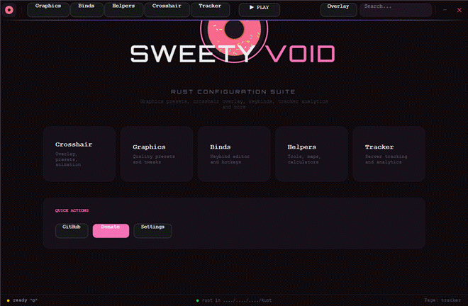
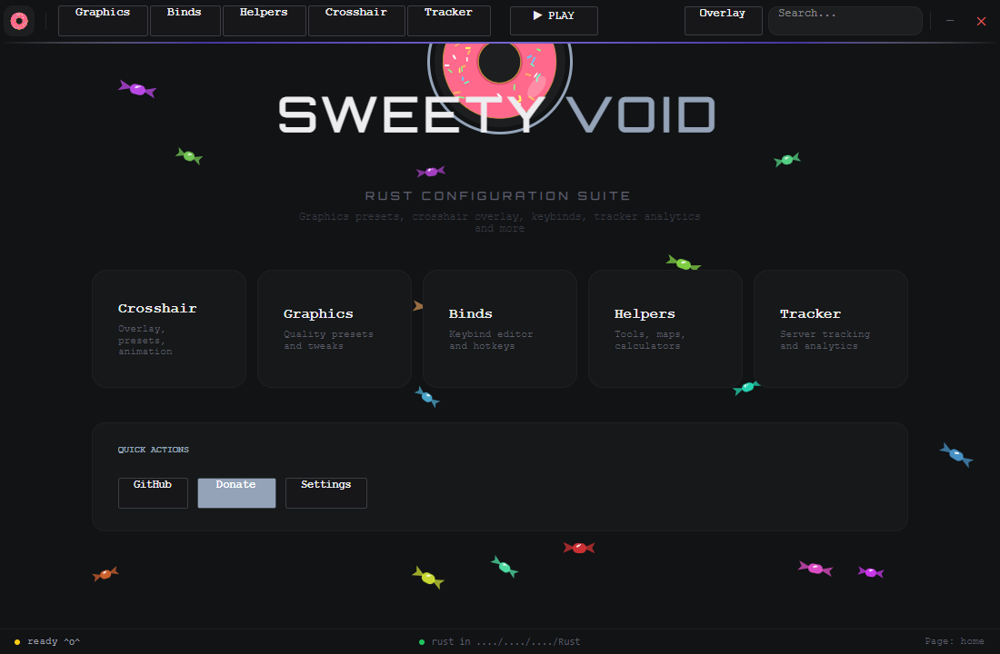
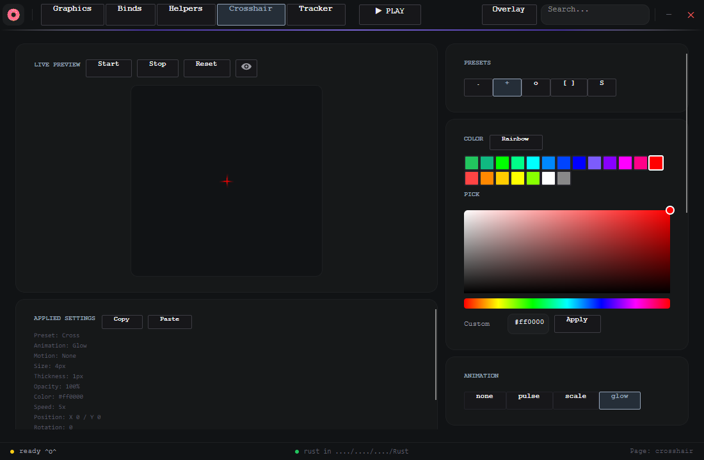
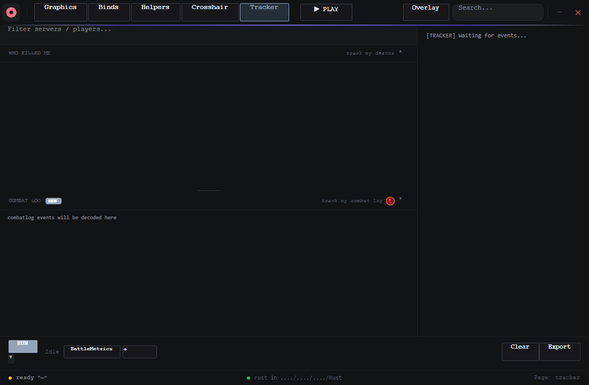
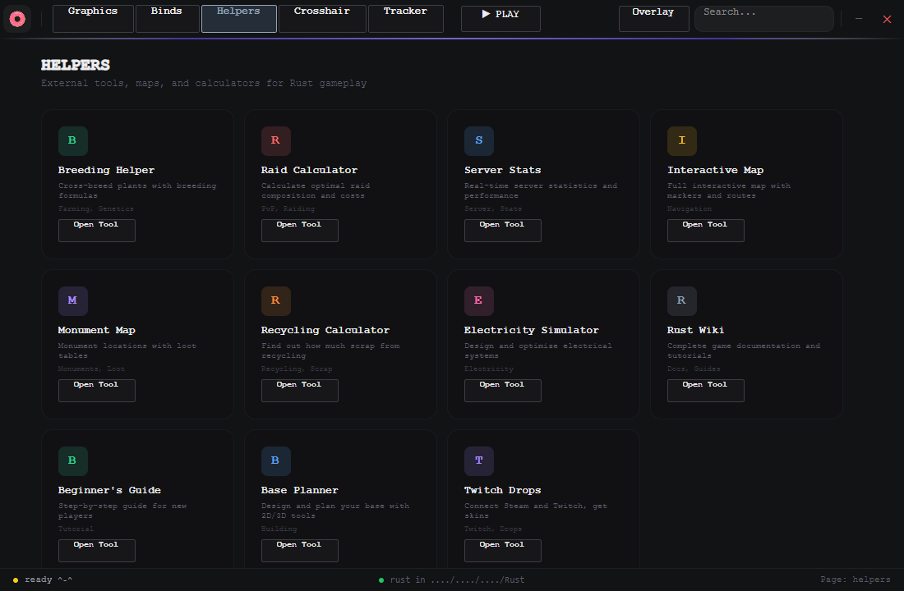
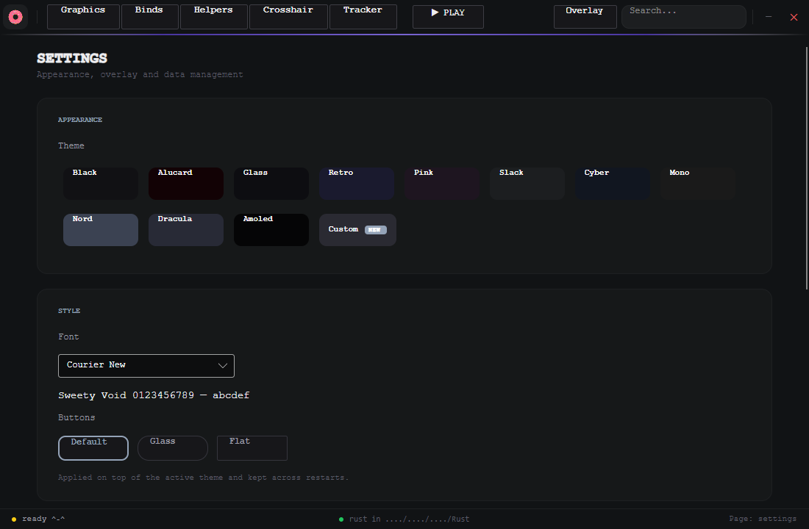
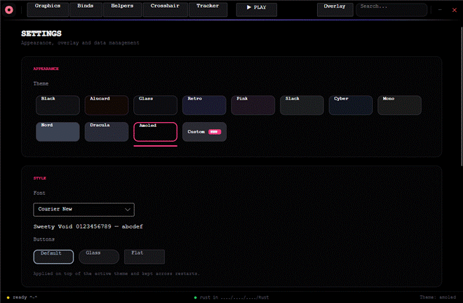
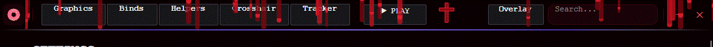

<p align="center">
  
</p>

<h1 align="center">SWEETY VOID</h1>

<p align="center">
  <b>A flat, configuration suite for Rust</b><br/>
  Crosshair overlay · session tracker · helpers · themes
</p>

<p align="center">
  <a href="https://github.com/zeuthe/void-ui/releases/latest"></a>
  <a href="https://github.com/zeuthe/void-ui/releases"></a>
  <a href="LICENSE.txt"></a>
  
</p>

---

## What is it?

**Sweety Void** is a Windows desktop app that bundles the tools a Rust player keeps in
twenty browser tabs into one dark, monospace window: a fully customisable crosshair
overlay, a session/death tracker, quick links to community tools — and a look that
never leaves the terminal aesthetic. Hard lines, no gradients, no glow (unless you
ask for it), rounded corners everywhere.

Everything you change is written to disk immediately and survives restarts.

## Contents

- [Pages](#pages)
  - [Home](#home)
  - [Crosshair](#crosshair)
  - [Tracker](#tracker)
  - [Helpers](#helpers)
  - [Settings](#settings--themes)
- [Themes](#themes)
- [Install](#install)
- [Build from source](#build-from-source)
- [Roadmap](#roadmap)
- [License](#license)

## Pages

### Home



The launcher screen: jump straight to any page, or use the **search box** in the top
bar (`Ctrl+F`-style, just type) to search pages *and* themes — type `alucard` and hit
Enter to switch the whole app to it. Candy confetti rains down on every visit, the
status bar below reports the app state and the update check.

### Crosshair



Design a crosshair and push it to the screen as a click-through overlay:

- **Live preview** — Start / Stop the real overlay from the button, or preview in the
  box without touching the game.
- **Presets** — dot, cross, ring, brackets, S-shape; every preset is a starting point,
  not a cage.
- **Colour** — quick palette, rainbow mode, full HSV picker with a hex field.
- **Animation** — none / pulse / scale / glow, with speed control.
- **Readout** — the *Applied settings* panel prints the exact state
  (size, thickness, opacity, colour, position, rotation) and lets you **copy/paste**
  configurations to share with friends.
- **Hotkey** — bind show/hide to any key (default `F8`); the bind is watched globally,
  so it works while the game has focus.

### Tracker



Two synchronized panels — **deaths** on top, **combat log** below — split by a
draggable handle that also collapses either side when you need room:

- **RUN** starts parsing; the parse mode picker selects *Once*, *Interval* or
  *Permanent* (with `h`/`m`/`s` interval fields).
- Session stats accumulate while the app runs; the curtain overlay marks
  the tracking state so you always know if it is armed.
- Settings persist — closing the app never resets your configuration.

### Helpers



Curated shortcuts to the Rust tools people actually use — breeding, raid cost
calculators, monument maps, electricity simulator, base planner, wiki — one click,
no bookmark digging.

### Settings & Themes



Two independent layers on top of the theme:

- **Appearance** — 12 built-in themes plus a **Custom** theme (a small editor opens
  with per-role colour pickers, and the custom theme is applied live).
- **Style** — a global **font override** (13 monospace fonts with live preview) and a
  **button style** override (Default / Glass / Flat).

Both are layered *on top of* the active theme and kept across restarts, so you can
mix, say, Dracula with Courier New and flat buttons.

## Themes

Thirteen looks, from restrained to unhinged — Black, Alucard, Glass, Retro, Pink,
Slack, Cyber, Mono, Nord, Dracula, Amoled and your own Custom.

<p align="center">
  
</p>

**Alucard** deserves its own line: blood trickles slide down the title bar over a
black-red palette, pulsing slowly, with a gothic cross watching from the corner.

<p align="center">
  
</p>

## Install

1. Grab **`VoidUI.Setup.exe`** from the
   [latest release](https://github.com/zeuthe/void-ui/releases/latest).
2. Run it — the installer offers components, installs to a folder of your choice and
   can launch the app when done.

Silent install (used by the in-app updater):

```powershell
.\VoidUI.Setup.exe --silent --dir "$env:LOCALAPPDATA\Programs\Sweety Void" --launch
```

Settings live in `%LOCALAPPDATA%\VoidUI\settings.json` — plain JSON, safe to edit or
copy between machines. The app checks `api.github.com/repos/zeuthe/void-ui/releases/latest`
on start and offers to download + install updates silently.

## Build from source

Requirements: [.NET 8 SDK](https://dotnet.microsoft.com/download/dotnet/8.0), Windows.

```powershell
# run the app
dotnet build VoidUI.csproj
.\_build\bin\net8.0-windows\VoidUI.exe

# build the installer (auto-bumps the version in Properties/AssemblyInfo.cs,
# publishes the app, assembles the payload and packs Nullsoft Scriptable
# Install System output into _build/installer/VoidUI.Setup.exe)
.\build-installer.ps1

# keep the version, just rebuild the installer
.\build-installer.ps1 -NoBump
```

## Roadmap

- **Graphics page** — quality presets and tweaks *(placeholder today)*.
- **Binds editor** — visual keybind editor *(placeholder today)*.
- More tracker analytics and helpers.

## Tech

Avalonia 11 · .NET 8 · no MVVM framework, no third-party UI kits — one window, plain
code-behind and XAML, tested through Windows UI Automation (every interactive control
carries an `AutomationId`, so the app is scriptable and testable without screen
coordinates).

## License

**Custom Source-Available License** © 2026 [zeuthe](https://github.com/zeuthe) — full text in
[LICENSE.txt](LICENSE.txt) (English translation + original Russian text).

In short: fork and modify freely — personal, educational, non-commercial or commercial — provided you
keep clear attribution with a link to this repository in your product description and its About
section, leave the author's built-in donation and sales mechanisms untouched, and add no malware,
no third-party ads and no paywalls over the basic functionality. Third-party components (Avalonia,
.NET, QRCoder, Newtonsoft.Json) keep their own MIT licenses.

Not affiliated with Facepunch Studios. Use at your own risk.
